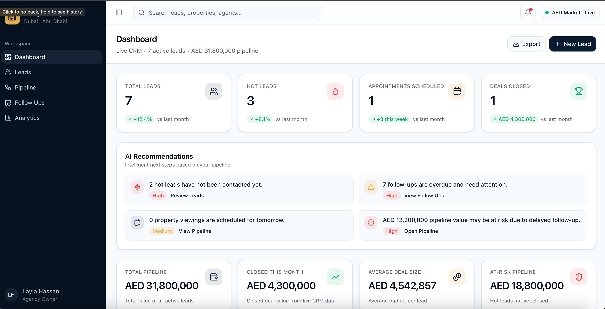
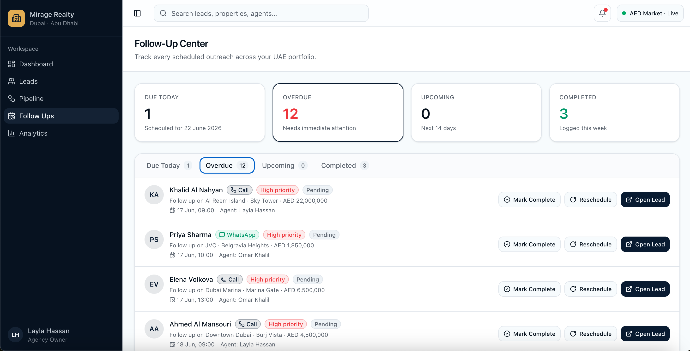
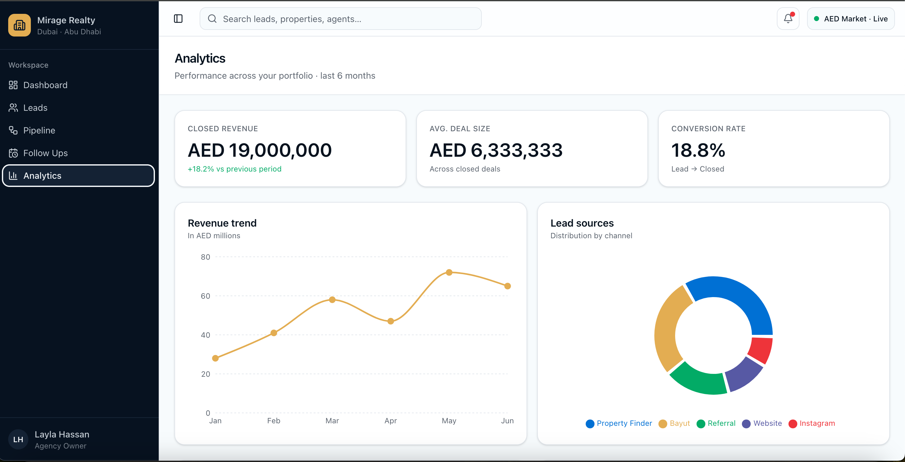
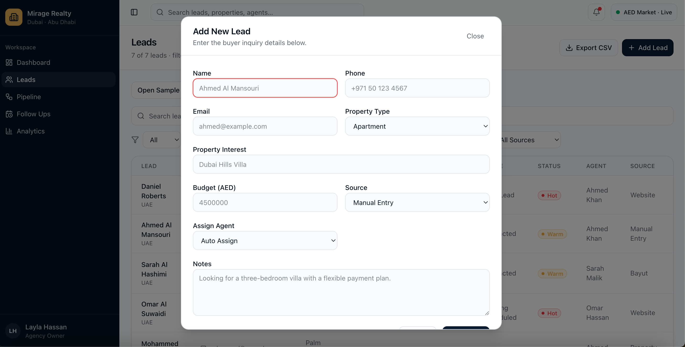
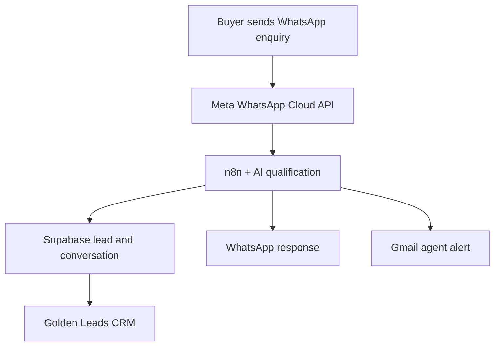

# Golden Leads UAE

**AI-powered WhatsApp lead qualification and CRM for real estate agencies.**

Golden Leads UAE helps agencies respond to property enquiries, collect buyer requirements, organize prospects in one place, and notify agents when a human follow-up is needed.

[**Open CRM demo**](https://golden-leads-uae.netlify.app) · [**Watch the video walkthrough**](docs/demo/golden-leads-demo.mp4)

## What it does

1. **Instant WhatsApp intake:** A buyer messages an agency in natural language.
2. **AI qualification:** The assistant responds and collects known requirements such as location, budget, property type, bedrooms, and timeline.
3. **Lead tracking:** Supabase stores prospect details and conversation history.
4. **CRM visibility:** The team can manage leads, pipeline stages, and follow-ups through the web dashboard.
5. **Agent alerts:** Gmail notifies the team when qualified handoff or message-delivery issues require attention.

The result: faster lead handling, less manual entry, and one organized place for conversations and follow-ups.

## Demo

🎬 [Watch the Golden Leads demonstration](docs/demo/golden-leads-demo.mp4)

See how a WhatsApp enquiry becomes an organized lead: AI conversation, automated qualification, CRM update, and agent notification.

## Screenshots

### Dashboard



### Lead management


### Sales pipeline


### Follow-ups



### Analytics



### Add lead form



---

## How it works



## Features

- AI-assisted, multi-turn WhatsApp lead qualification
- Real-estate requirement extraction and conversation history
- Lead database, sales pipeline, follow-up views, and agent assignment
- CRM dashboard and lead-source analytics
- Agent Gmail notifications and error alerts
- Responsive browser-based frontend

## Technology

| Component | Stack |
|---|---|
| CRM frontend | React, TypeScript, TanStack Start |
| Database | Supabase |
| Workflow | Self-hosted n8n (Docker) |
| Messaging | Meta WhatsApp Cloud API |
| AI inference | Groq-hosted language model |
| Notifications | Gmail |
| Web hosting | Netlify |


## Screenshots and case study

For a larger view, open any screenshot above. See the [project case study](docs/case-study/golden-leads-uae-case-study.pdf).

## Run the CRM locally

```bash
git clone https://github.com/YonatanMoges/golden-leads-uae.git
cd golden-leads-uae
npm install
npm run dev
```

Configure Supabase and webhook environment variables required by your deployment. 

## Author

**Yonatan Moges** · [GitHub](https://github.com/YonatanMoges) · [Live CRM](https://golden-leads-uae.netlify.app)
