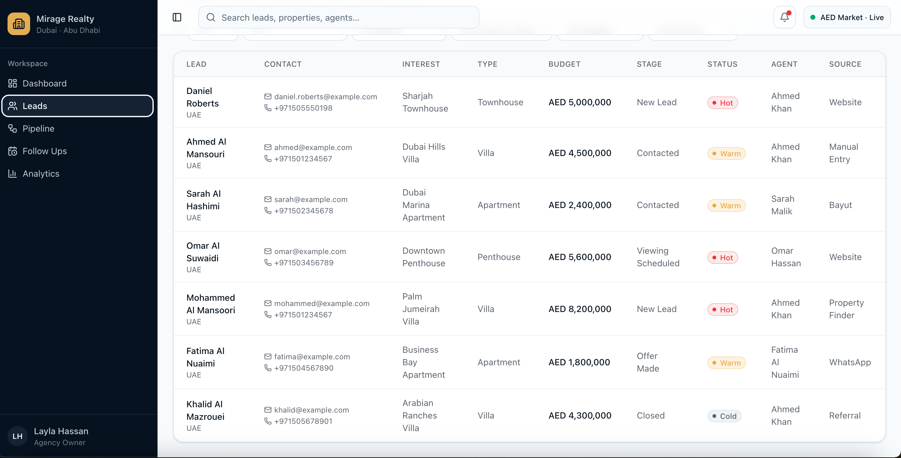
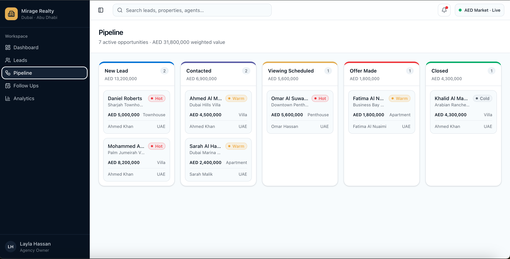
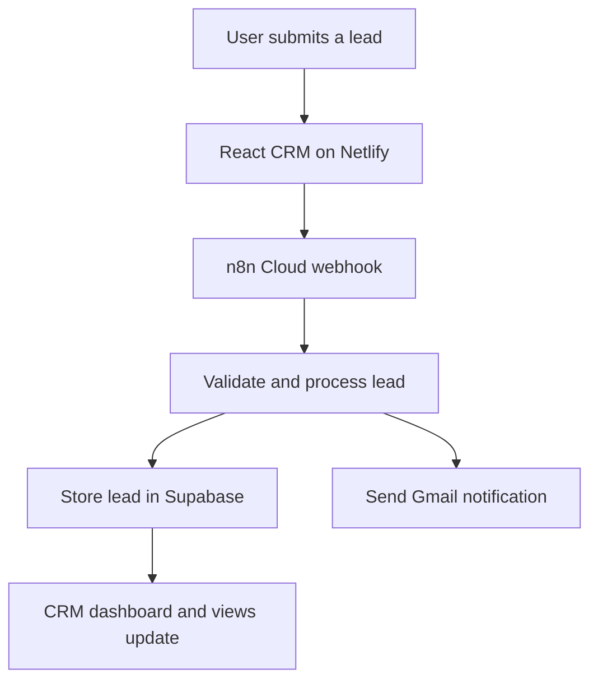

# Golden Leads UAE

An automated real-estate lead management system built to help agencies capture inquiries, organize prospects, track pipeline activity, schedule follow-ups, and notify sales teams without relying on disconnected spreadsheets or repetitive manual entry.

[](https://golden-leads-uae.netlify.app)
[](#technology-stack)
[](#system-architecture)
[](#technology-stack)

> **Project status:** Deployed and operational  
> **Live application:** [golden-leads-uae.netlify.app](https://golden-leads-uae.netlify.app)

---

## Overview

Golden Leads UAE is a portfolio project demonstrating how a real-estate agency can connect a polished CRM interface to a cloud-based automation workflow.

When a user submits a buyer inquiry through the CRM:

1. The form sends the inquiry to an n8n Cloud webhook.
2. The workflow validates and processes the submitted data.
3. The lead is stored in Supabase.
4. The sales team receives an email notification through Gmail.
5. The CRM reflects the new lead across its dashboard, lead database, pipeline, and follow-up views.

The result is a centralized lead-operations system that reduces manual data entry and helps sales teams respond to new opportunities more consistently.

---

## Demo

### Video walkthrough

The demo shows:

- Dashboard and business overview
- Lead database
- Sales pipeline
- Follow-up management
- Analytics
- New lead submission
- Automatic updates across the CRM
- n8n workflow execution
- Gmail notification delivery

> **Demo video:** Add the public video link here after uploading it.  
> Example: `[Watch the full demo](YOUR_VIDEO_URL)`

<!--
Optional alternative:
Upload a compressed demo file to docs/demo/ and replace the line above with:

[Watch the demo](docs/demo/golden-leads-demo.mp4)
-->

---

## Screenshots

Add the final screenshots to `docs/screenshots/` and keep the filenames used below.

### Dashboard


### Lead management



### Sales pipeline



### Follow-ups


### Analytics


### Add lead form


---

## Core Features

- Centralized real-estate lead database
- Dashboard with lead and pipeline summaries
- Lead stages from new inquiry to closing
- Visual sales pipeline
- Follow-up tracking
- Lead-source analytics
- Agent assignment
- Buyer contact and property-requirement capture
- Automated lead validation and processing
- Supabase database integration
- Automatic email notifications
- Cloud-hosted n8n workflow
- Responsive web interface
- Production deployment through Netlify

---

## System Architecture



### Data flow

```text
User
  ↓
Golden Leads UAE CRM
  ↓
n8n Cloud Webhook
  ├──→ Supabase Database
  └──→ Gmail Notification
  ↓
Updated Dashboard, Leads, Pipeline and Follow-ups
```

---

## Technology Stack

| Layer | Technology | Purpose |
|---|---|---|
| Frontend | React | CRM user interface |
| Application framework | TanStack Start | Application structure and routing |
| Language | TypeScript | Typed application development |
| Database | Supabase | Lead storage and retrieval |
| Automation | n8n Cloud | Workflow orchestration |
| Notifications | Gmail | New-lead email alerts |
| Hosting | Netlify | Production deployment |
| Version control | GitHub | Source-code management |

---

## Application Sections

### Dashboard

Provides a high-level overview of lead activity, pipeline distribution, agent performance, lead sources, and recent records.

### Leads

Stores prospect contact details, property interests, budgets, source information, assigned agents, and current stages.

### Pipeline

Displays opportunities according to their position in the sales process, making it easier to see where each buyer currently stands.

### Follow-ups

Surfaces leads that require future contact and helps reduce missed sales opportunities.

### Analytics

Summarizes lead sources, pipeline activity, conversion information, and overall CRM performance.

### Add Lead

Captures a new inquiry and starts the automation workflow without requiring direct access to the database or a spreadsheet.

---

## Automation Workflow

The production workflow is hosted on **n8n Cloud**.

It performs the following operations:

1. Receives lead data from the CRM webhook request.
2. Validates and normalizes the submitted fields.
3. Applies the lead-processing and assignment logic.
4. Creates the new record in Supabase.
5. Sends an email notification to the sales team.
6. Returns a successful response to the CRM.

The production workflow export is not included in this repository. This prevents deployment-specific configuration, webhook details, account identifiers, and credentials from being exposed publicly.

A sanitized workflow export may be added later for technical demonstration.

---

## Local Development

### Prerequisites

Install the following before running the project:

- Node.js 18 or later
- npm
- A Supabase project
- An n8n Cloud account or self-hosted n8n instance

### Installation

```bash
git clone https://github.com/YonatanMoges/golden-leads-uae.git
cd golden-leads-uae
npm install
```

### Environment variables

Create a `.env.local` file in the project root.

```env
VITE_SUPABASE_URL=your_supabase_project_url
VITE_SUPABASE_ANON_KEY=your_supabase_anon_key
VITE_N8N_WEBHOOK_URL=your_n8n_webhook_url
```

> Confirm the exact environment-variable names used in the source code before deployment. Never commit real credentials or private webhook URLs.

### Start the development server

```bash
npm run dev
```

Open the local URL shown in the terminal.

### Production build

```bash
npm run build
```

---

## Suggested Repository Structure

```text
golden-leads-uae/
├── docs/
│   ├── screenshots/
│   │   ├── dashboard.png
│   │   ├── leads.png
│   │   ├── pipeline.png
│   │   ├── follow-ups.png
│   │   ├── analytics.png
│   │   └── add-lead.png
│   └── demo/
├── public/
├── src/
├── .env.example
├── .gitignore
├── package.json
└── README.md
```

---

## Security Notes

- Secrets and API keys must remain in environment variables.
- Supabase service-role keys must never be exposed in frontend code.
- Production webhook URLs should not be published unnecessarily.
- Screenshots and videos should hide private email addresses, credentials, database identifiers, and webhook URLs.
- Any future workflow export should be sanitized before it is committed.

---

## Business Value

Golden Leads UAE demonstrates how an agency can replace a fragmented lead-handling process with one connected system.

The solution is designed to:

- Reduce repetitive manual entry
- Centralize buyer information
- Improve visibility across the sales pipeline
- Support faster responses to new inquiries
- Reduce forgotten follow-ups
- Give teams a clearer view of lead sources and performance
- Connect the customer-facing interface to back-office automation

---

## Future Improvements

- In-app lead editing
- Stage changes directly from the pipeline
- Agent reassignment
- Lead notes and activity history
- Authentication and role-based access
- WhatsApp notifications and messaging
- Calendar integration
- Duplicate-lead detection
- Advanced lead scoring
- Automated follow-up sequences
- Additional reporting and conversion metrics

---

## Project Context

This project was developed as a practical portfolio system for real-estate lead operations in the UAE. It demonstrates frontend development, database integration, workflow automation, cloud deployment, and business-process design in one end-to-end application.

---

## Author

**Yonatan Moges**

- GitHub: [@YonatanMoges](https://github.com/YonatanMoges)
- Project repository: [golden-leads-uae](https://github.com/YonatanMoges/golden-leads-uae)
- Live application: [Golden Leads UAE](https://golden-leads-uae.netlify.app)

---

## Disclaimer

Golden Leads UAE is a portfolio demonstration project. The sample names, contact details, properties, budgets, and performance data shown in the application are fictional and are used only to demonstrate the CRM workflow.
